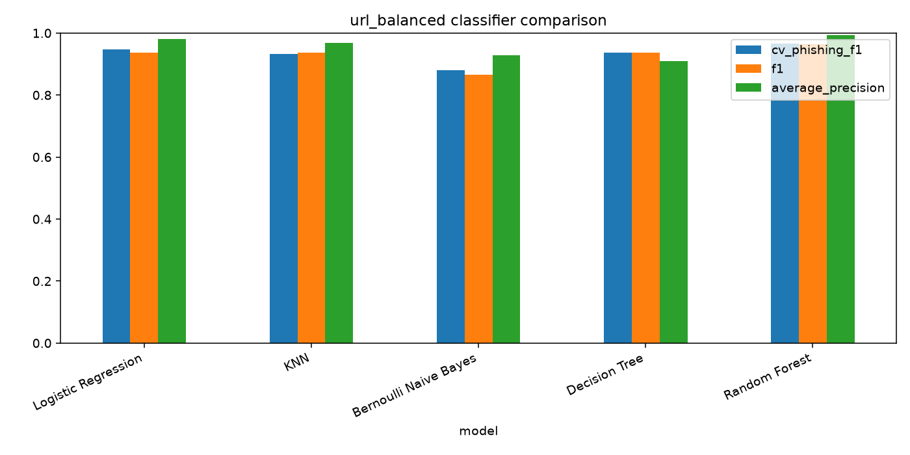
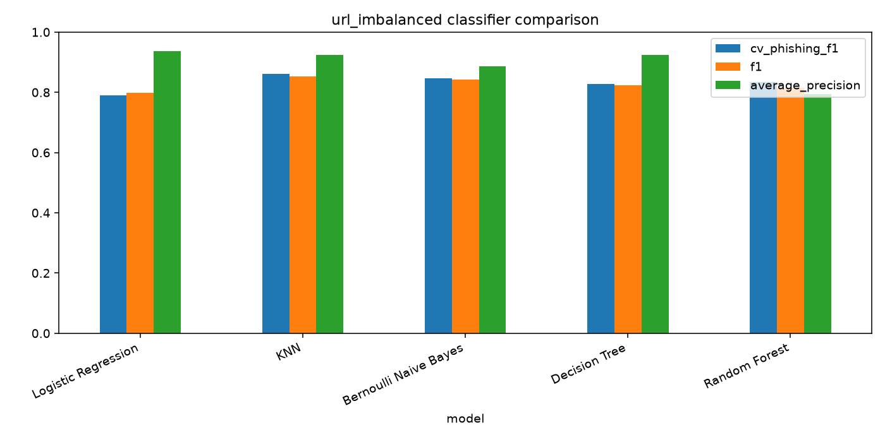

# Phishing detection capstone

Compare five supervised classifiers across two URL corpora and a text-email corpus, with preprocessing fitted inside cross-validation and model selection based on phishing-class F1.

## Run
Python 3.12:
```bash
python -m pip install -r requirements-dev.txt
python evaluate_models.py
python -m pytest tests
python -m streamlit run app.py
```
Launch Jupyter from the repository or notebooks directory. The three modeling notebooks display measured results and retrain when RECOMPUTE=True. EDA and cleaning read the actual repository-relative source files.

## Data
The committed datasets are `dataset_phishing.csv`, `web-page-phishing.csv`, and `Phishing_Email_Dataset.csv`. The email source now has 9,000 rows; historical notebook results from a larger corpus are no longer applicable. Missing/blank email text, exact duplicate text and conflicting text labels are removed before splitting. Repeated URL identifiers and exact tabular duplicates are handled before holdout creation.
Original provenance is described in the historical capstone reports. Exact Kaggle source/version URLs were not recorded, so provenance remains incomplete and should be resolved before reusing the corpora beyond this portfolio.

## Evaluation
Stratified 80/20 holdout; three-fold stratified training CV; two documented candidate configurations per model. The scorer is phishing-class F1. Every transformation is part of the estimator pipeline, including TF-IDF and SVD for text KNN, or scaling for tabular Logistic Regression/KNN. No preprocessing sees the validation fold during fitting.
The app remains a fixed Random Forest demonstration, evaluated separately with its exact TF-IDF configuration. It is not presented as the strongest email model.

### url_balanced

11,429 cleaned records. Training-CV F1 selects **Random Forest**.

| model | cv_phishing_f1 | accuracy | precision | recall | f1 | average_precision |
| --- | --- | --- | --- | --- | --- | --- |
| Logistic Regression | 0.9471 | 0.9366 | 0.9408 | 0.9318 | 0.9363 | 0.9800 |
| KNN | 0.9316 | 0.9374 | 0.9537 | 0.9195 | 0.9363 | 0.9683 |
| Bernoulli Naive Bayes | 0.8805 | 0.8666 | 0.8728 | 0.8583 | 0.8655 | 0.9294 |
| Decision Tree | 0.9371 | 0.9374 | 0.9417 | 0.9326 | 0.9371 | 0.9106 |
| Random Forest | 0.9657 | 0.9646 | 0.9658 | 0.9633 | 0.9645 | 0.9934 |

### url_imbalanced

21,891 cleaned records. Training-CV F1 selects **KNN**.

| model | cv_phishing_f1 | accuracy | precision | recall | f1 | average_precision |
| --- | --- | --- | --- | --- | --- | --- |
| Logistic Regression | 0.7890 | 0.7399 | 0.9142 | 0.7077 | 0.7978 | 0.9364 |
| KNN | 0.8612 | 0.7831 | 0.8389 | 0.8674 | 0.8529 | 0.9251 |
| Bernoulli Naive Bayes | 0.8465 | 0.7616 | 0.8061 | 0.8838 | 0.8431 | 0.8855 |
| Decision Tree | 0.8278 | 0.7700 | 0.9254 | 0.7427 | 0.8240 | 0.9235 |
| Random Forest | 0.8340 | 0.7324 | 0.8162 | 0.8142 | 0.8152 | 0.7945 |

### email

8,598 cleaned records. Training-CV F1 selects **Logistic Regression**.

| model | cv_phishing_f1 | accuracy | precision | recall | f1 | average_precision |
| --- | --- | --- | --- | --- | --- | --- |
| Logistic Regression | 0.9454 | 0.9622 | 0.9349 | 0.9678 | 0.9511 | 0.9906 |
| KNN | 0.9221 | 0.9500 | 0.9315 | 0.9372 | 0.9344 | 0.9645 |
| Bernoulli Naive Bayes | 0.8998 | 0.9238 | 0.8480 | 0.9740 | 0.9066 | 0.9804 |
| Decision Tree | 0.8645 | 0.8983 | 0.8610 | 0.8729 | 0.8669 | 0.8089 |
| Random Forest | 0.9404 | 0.9570 | 0.9474 | 0.9387 | 0.9431 | 0.9858 |
| App Random Forest (fixed parameters) | nan | 0.9576 | 0.9489 | 0.9387 | 0.9438 | 0.9865 |

## Interpretation and limits
Random Forest leads the balanced URL comparison, KNN leads the imbalanced URL comparison, and Logistic Regression leads the email comparison by training-CV F1. No universal winner follows from these corpora. Small score differences do not establish statistical superiority.

Deduplication cannot remove all near-duplicate messages, related campaigns or shared domains. Random holdout results do not establish performance on new sources or future campaigns. Class prevalence differs from real inboxes. Model probabilities are uncalibrated scores. The app processes text only and does not inspect attachments, sender authentication or destination sites.

The DOCX reports preserve the original capstone work. The comparison PNGs have been regenerated from the current results. They are historical and superseded for current model results by the regenerated notebooks, tables and comparison figures. See [results](results/) for package versions, sample counts and selected hyperparameters.




