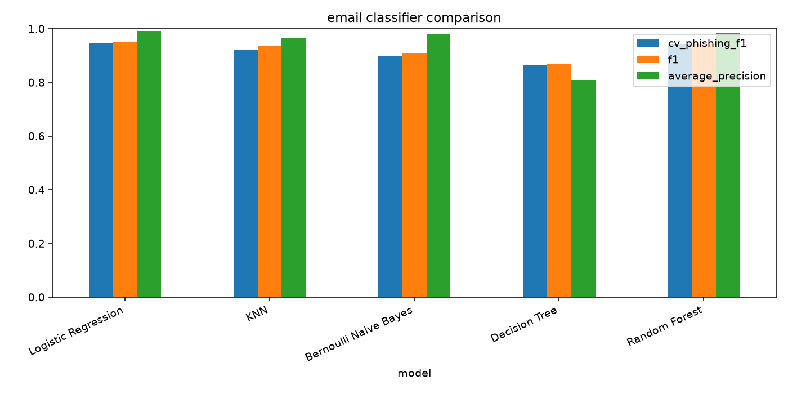

# Phishing Detection Capstone

## Overview

A supervised learning comparison for phishing URLs and emails, with a Streamlit app that analyzes email subjects and bodies using a tuned Random Forest classifier.

## Objective

Distinguish phishing from legitimate URLs and emails while comparing model performance across balanced and imbalanced datasets.

## Data

Three Kaggle datasets are included in [datasets](datasets/): a balanced URL dataset derived from a 2021 research study, an imbalanced URL dataset, and an imbalanced email dataset. URL data uses extracted features; email data uses text and class labels.

## Approach

1. Inspect and clean the datasets, then explore relationships between features and phishing status.
2. Apply appropriate preprocessing, including standardization and TF-IDF for email text.
3. Compare Logistic Regression, K-Nearest Neighbors, Bernoulli Naive Bayes, Decision Tree, and Random Forest.
4. Evaluate test accuracy, cross-validation accuracy, and phishing-class F1-score against an 80% benchmark and the Logistic Regression baseline.

The [notebooks](notebooks/) contain data preparation, exploration, and separate modeling analyses for each dataset. Detailed technical and nontechnical reports are in [capstone_reports](capstone_reports/).

## Results

Random Forest exceeded or approximately matched the Logistic Regression baseline across all three datasets. Bernoulli Naive Bayes fell below the 80% benchmark on the second dataset; the other models met the benchmark across the datasets.

| Dataset | Reported comparison |
| --- | --- |
| Balanced URLs | All models exceeded 80%; Random Forest and KNN outperformed the baseline. |
| Imbalanced URLs | Bernoulli Naive Bayes fell below 80%; the other models outperformed the baseline. |
| Emails | All models exceeded 80%; Random Forest approximately matched the baseline. |



See [visuals](visuals/) for the other dataset comparisons.

## Tools

Python, NumPy, pandas, scikit-learn, Matplotlib, Jupyter Notebook, Google Colab, and Streamlit.

## How to Run

Clone the repository and enter its directory:

```bash
git clone https://github.com/alfred-abraham/phishing_detection_capstone.git
cd phishing_detection_capstone
```

Create and activate a virtual environment:

- **Windows PowerShell:** `python -m venv .venv`, then `.\.venv\Scripts\Activate.ps1`.
- **macOS/Linux:** `python3 -m venv .venv`, then `source .venv/bin/activate`.

Install dependencies and start the app:

```bash
python -m pip install -r requirements.txt
python -m streamlit run app.py
```

Open [localhost:8501](http://localhost:8501) and paste an email's subject and body. The app returns a prediction and estimated phishing probability. It trains once from `datasets/Phishing_Email_Dataset.csv` and caches the TF-IDF + Random Forest pipeline; the first analysis may take 30–60 seconds. Press `Ctrl+C` to stop.

For the analysis, open the preparation notebook, then EDA, then the three modeling notebooks in [notebooks](notebooks/). Check dataset paths before running.

To deploy on Streamlit Community Cloud, select this repository and set `app.py` as the entry point. No secrets or external services are required.

## Limitations and Next Steps

- Older datasets may not represent current phishing tactics.
- Phishing prevalence is higher than in typical real-world traffic.
- Email TF-IDF features were capped at 1,000 to limit computation.
- Future work includes newer data, more representative class ratios, and TF-IDF feature-count experiments.

## License

See [LICENSE](LICENSE) for repository licensing. Refer to the dataset sources for their usage terms.
